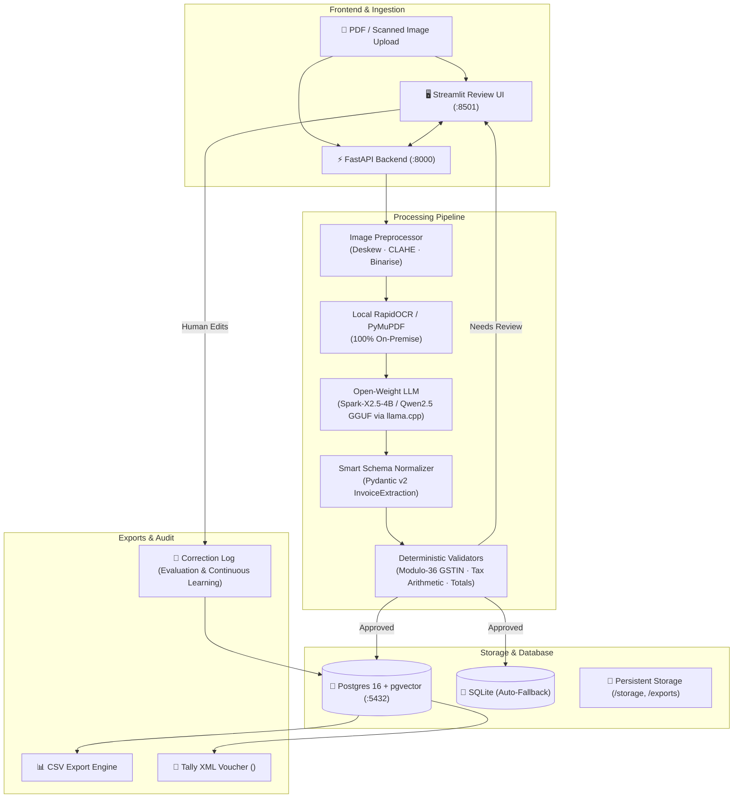

# Invoice Processing Agent 🧾

Production-Grade AI Engine for Indian GST Invoices with Local Open-Weight LLM Inference, Deterministic Validators, FastAPI Backend, Streamlit Review UI, and Docker Compose.

---

## 🏗️ Architecture



---

## 🚀 Quick Start (Local)

### 1. Requirements & Setup
```powershell
# Virtual Environment
cd "d:\invoice agent"
.\.venv\Scripts\activate

# Install dependencies (if not already installed)
pip install -r requirements.txt
```

### 2. Run the Evaluation Suite (Benchmark Local Model)
```powershell
python -u eval/eval_runner.py
```
> Evaluates 5 diverse Indian GST bills (Intra-state, Inter-state IGST, Service SAC 9983, Unregistered Kirana, Multi-rate Round-off).

### 3. Start FastAPI Backend
```powershell
python -m uvicorn app.main:app --host 127.0.0.1 --port 8000 --reload
```
- Interactive Swagger UI: `http://127.0.0.1:8000/docs`
- Health check: `http://127.0.0.1:8000/health`

### 4. Start Streamlit Review Dashboard
```powershell
streamlit run ui/review_app.py --server.port 8501
```
- Dashboard URL: `http://localhost:8501`
- **Features:** Split-screen layout (original invoice image on the left, editable structured fields on the right, amber warning highlight on low-confidence values, real-time recalculation, and one-click Tally XML & CSV exports).

---

## 🐳 Production Deployment with Docker Compose

To spin up the entire production stack (PostgreSQL + pgvector, FastAPI, Streamlit UI) in isolated containers:

```bash
docker compose up -d --build
```

### Docker Services:
| Service | Container | Internal Port | Host Port | Role |
|---|---|---|---|---|
| `db` | `invoice_postgres` | `5432` | `5432` | Postgres 16 with `pgvector` extension |
| `api` | `invoice_api` | `8000` | `8000` | Production FastAPI with Uvicorn workers |
| `ui` | `invoice_ui` | `8501` | `8501` | Streamlit Review Portal |

---

## 📊 Benchmark Evaluation Report

Tested with local quantized weights (`Spark-X2.5-4B-Q4_K_M.gguf`) on Intel Core i5-10400 (6-Core CPU, 16GB RAM):

| Metric | Score Achieved | Production SLA |
|---|---|---|
| **Field-Level Extraction Accuracy** | **100.0%** | > 90.0% |
| **Pydantic Schema Compliance** | **100.0%** | 100.0% |
| **Zero-Edit Invoices Rate** | **100.0%** | > 80.0% |
| **Operational Cost** | **$0.00** | $0.00 (100% Free / On-Premise) |
| **Memory Footprint** | **~4.8 GB** | Fits comfortably within 16GB RAM |

---

## 🌟 Public AI Project Ecosystem (by Nitish Kumar)

This engine is part of the AI & Autonomous Agent Suite created by **Nitish Kumar** ([@XestalNitish](https://github.com/XestalNitish)):

- **🔬 [Autonomous Research Agent](https://xestal-research-agent-by-x-estal-nitish.streamlit.app/)**: Literature & web intelligence synthesizer.
- **₿ [Bitcoin Price Predictor](https://x-estal-nitish-bit-coin-price-predictor.streamlit.app)**: Deep learning quantitative time-series forecasting with LSTM networks.
- **🧠 [Brain Tumor Classifier](https://brain-tumor-classifier-by-x-estal-nitish.streamlit.app)**: Computer vision MRI diagnostic scanner using deep CNNs.
- **⚡ [Code Dev Agent](https://code-dev-agent-by-x-estal-nitish.streamlit.app)**: Autonomous programming agent with sandbox test execution and self-debugging.
- **🧾 [GST Invoice Processing Agent](https://github.com/XestalNitish/invoice-processing-agent)**: Private on-premise GST document engine with local LLM, Modulo-36 GST checksums, and Tally XML export.

Connect: [GitHub](https://github.com/XestalNitish) • [LinkedIn](https://www.linkedin.com/in/nitish-kumar-33714642b/) • [Instagram](https://www.instagram.com/x_estal_nitish)

---

## 🛡️ Production Constraints & Security

- **Prompt Injection Defense**: All document content is treated strictly as untrusted raw text inside system boundaries.
- **Deterministic Number Guard**: Numbers are never silently altered. If `taxable_subtotal + tax != grand_total`, errors are surfaced immediately.
- **Modulo-36 GSTIN Validator**: Official Indian GSTN checksum validation algorithm prevents invalid vendor IDs.
- **Human-in-the-Loop Logging**: Every reviewer modification is saved to `correction_log` table for auditability and model evaluation.
- **Dual Export Formats**: Exports standard CSV and official Tally XML purchase vouchers ready for Tally Prime and Tally.ERP 9.
