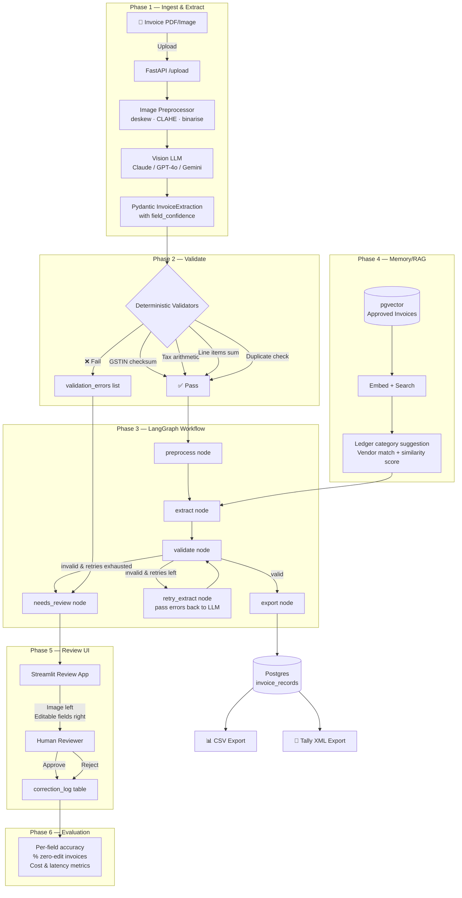

# Invoice Processing Agent 🧾

An end-to-end AI pipeline for extracting, validating, and exporting GST invoices for small Indian businesses.

## Architecture



## Repository Structure

```
invoice agent/
├── app/
│   ├── core/
│   │   └── config.py          # Pydantic-settings; all secrets from .env
│   ├── nodes/
│   │   └── schemas.py         # LineItem · TaxBreakup · InvoiceExtraction · InvoiceRecord
│   ├── preprocessing/
│   │   └── image_processor.py # deskew · CLAHE · adaptive threshold · PDF→PNG
│   ├── extraction/
│   │   └── extractor.py       # Vision LLM call (Anthropic/OpenAI/Gemini/Local)
│   ├── nodes/
│   │   └── validators.py      # Deterministic validators (Phase 2)
│   ├── db/
│   │   ├── models.py          # SQLAlchemy ORM (invoice_records, correction_log)
│   │   ├── session.py         # Session factory + init_db()
│   │   └── crud.py            # create/read/update + duplicate detection
│   ├── graph/
│   │   └── state.py           # LangGraph TypedDict state
│   ├── pipeline_phase1.py     # Phase 1 orchestrator (preprocess→extract→store)
│   └── main.py                # FastAPI app (Phase 3+)
├── tests/
│   └── phase1/
│       ├── test_schemas.py        # 32 schema tests
│       ├── test_preprocessing.py  # 14 image pipeline tests
│       └── test_extractor.py      # 16 LLM extractor tests (all mocked)
├── ui/
│   └── review_app.py          # Streamlit review UI (Phase 5)
├── local_llm/
│   └── local_llm_service.py   # Local llama-server adapter
├── storage/
│   ├── raw_images/            # Original uploaded files
│   └── processed_images/      # Preprocessed page PNGs
├── exports/                   # CSV + Tally XML outputs
├── .env.example               # Template for secrets
├── Requirements.txt
└── docker-compose.yml
```

## Phase 1 — What's Built

### Schema ([`app/nodes/schemas.py`](app/nodes/schemas.py))

| Model | Key fields |
|---|---|
| `LineItem` | description, hsn_sac, quantity, unit_price, discount_amount, tax_rate_percent, taxable_amount, total_amount |
| `TaxBreakup` | taxable_subtotal, cgst_amount, sgst_amount, igst_amount, cess_amount, tds_amount, round_off, grand_total |
| `InvoiceExtraction` | vendor+buyer info, GSTIN (both sides), invoice_number, invoice_date, place_of_supply, is_inter_state, line_items[], tax_breakup, field_confidence{} |
| `InvoiceRecord` | Full DB record = extraction + file metadata + processing state + human review fields |

**Design rules enforced at schema level:**
- All monetary amounts: max 2 decimal places; raises `ValidationError` if more (never silently rounds)
- `is_inter_state` auto-inferred from IGST vs CGST+SGST when not set by LLM
- `field_confidence` values clamped to [0.0, 1.0]
- GSTIN auto-uppercased; empty/whitespace → `None`

### Image Preprocessing ([`app/preprocessing/image_processor.py`](app/preprocessing/image_processor.py))

Pipeline per page: **PDF→image** (pymupdf, 200 DPI) → **deskew** (Hough line transform, ±20°) → **CLAHE contrast** (LAB L-channel, clip=2.0) → **adaptive binarise** (Gaussian + adaptive threshold) → base64 PNG

### Vision LLM Extraction ([`app/extraction/extractor.py`](app/extraction/extractor.py))

- Supports: **Anthropic Claude** (default), OpenAI GPT-4o, Google Gemini, local llama-server
- Prompt injection hardened: system prompt explicitly instructs model to treat all invoice text as raw data
- Handles markdown-fenced JSON responses; strips fences before parsing
- Returns `(InvoiceExtraction, raw_llm_response_str)` tuple for full auditability
- Provider map rebuilt on each call (testable via `monkeypatch`)

### Database ([`app/db/`](app/db/))

- `invoice_records` — one row per document, stores full extraction JSON, processing state, human review, export paths
- `correction_log` — every human edit logged for Phase 6 evaluation
- `find_duplicates()` — matches on (vendor_name, invoice_number, grand_total, date) with ₹1 tolerance

## Quick Start

```bash
# 1. Copy and fill environment variables
cp .env.example .env
# Edit ANTHROPIC_API_KEY and DATABASE_URL

# 2. Install dependencies
pip install -r Requirements.txt

# 3. Run Phase 1 tests (no DB/API key needed)
pytest tests/phase1/ -v

# 4. Run Phase 1 on a real invoice (needs API key + DB)
python -c "
from app.pipeline_phase1 import run_phase1
result = run_phase1('path/to/invoice.pdf', persist_to_db=False)
print(result.status, result.extraction.vendor_name)
"
```

## Sample Export (CSV)

```csv
invoice_number,vendor_name,vendor_gstin,invoice_date,taxable_subtotal,cgst,sgst,igst,grand_total
INV-2024-001,Acme Supplies Pvt Ltd,27AABCU9603R1ZX,2024-03-15,10000.00,900.00,900.00,0.00,11800.00
```

## Sample Export (Tally XML) — Phase 3

```xml
<ENVELOPE>
  <HEADER><TALLYREQUEST>Import Data</TALLYREQUEST></HEADER>
  <BODY>
    <IMPORTDATA>
      <REQUESTDESC><REPORTNAME>Vouchers</REPORTNAME></REQUESTDESC>
      <REQUESTDATA>
        <TALLYMESSAGE>
          <VOUCHER VCHTYPE="Purchase">
            <DATE>20240315</DATE>
            <PARTYLEDGERNAME>Acme Supplies Pvt Ltd</PARTYLEDGERNAME>
            <AMOUNT>11800.00</AMOUNT>
          </VOUCHER>
        </TALLYMESSAGE>
      </REQUESTDATA>
    </IMPORTDATA>
  </BODY>
</ENVELOPE>
```

## Constraints Honoured

- ✅ Never silently fix numbers — `ValidationError` raised on > 2 dp, CGST≠SGST, sum mismatches
- ✅ Prompt injection safe — system prompt treats all invoice text as untrusted data
- ✅ PII masking configurable via `PII_MASKING_ENABLED` in `.env`
- ✅ DB encryption at rest: `DB_ENCRYPT_AT_REST` flag (pgcrypto in Phase 3)
- ✅ All LLM calls wrapped to surface errors, never swallowed

## Test Coverage — Phase 1

| Test file | Tests | Status |
|---|---|---|
| `test_schemas.py` | 32 | ✅ All pass |
| `test_preprocessing.py` | 14 | ✅ All pass |
| `test_extractor.py` | 16 | ✅ All pass |
| **Total** | **62** | **✅ 62/62** |
